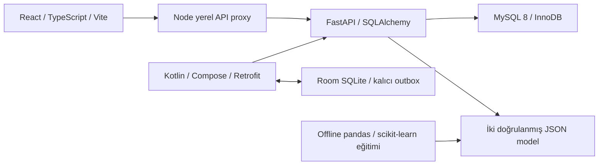

# ByteMe — AVATAR 2026

Gıda işletmesi için yerel prototip: alış ve lot girişi, dış üretim ve gerçek EKP, kuzu parçalama/maliyet dağıtımı, lotlu satış/sevkiyat, kesin FK izlenebilirliği/geri çağırma ve iki sentetik ML modeli. React yönetim paneli ile Kotlin Android satış uygulaması aynı FastAPI/MySQL kayıtlarını kullanır.

**28 Ekim güncel kabul:** [Final release ve üç GO/NO-GO](docs/FINAL_RELEASE_READINESS.md) · [Kullanım kılavuzu](docs/USER_GUIDE.md) · [Jüri demo runbook'u](docs/DEMO_RUNBOOK.md). Main tabanı `02a080677dee59a3940ad232d4fa716c92a84469`, PR #1–#34'ün merge geçmişi doğrulandı. [25–26 Ekim tarihsel kabulü](docs/RELEASE_READINESS.md) korunur. Teslim tarihi **1 Kasım 2026 23:59 Europe/Istanbul** kullanıcı talimatıdır; PDF'de tarih yoktur. [Gereksinimler ve açık kapsam](docs/requirements.md).

Bağımsız transfer, müşteri iadesi/iptali, kg rework, kayıtlı ikinci kademe, web kârlılık, salt-okunur uyarı merkezi ve geçici proforma/satış özeti A4 PDF akışları da mevcuttur. Resmî mali belge veya internete açık üretim servisi iddiası yoktur.

**Yalnız güvenilir yerel demo.** X-API-Key kullanıcı oturumu/rol sistemi değildir. İnternet üretimi, gerçek kullanıcı yetkilendirmesi ve TLS dağıtımı uygulanmadı. Bütün yayımlanan Compose portları `127.0.0.1` ile sınırlıdır. URL olarak `http://127.0.0.1:5173` kullanın; `localhost` farklı origin'dir.

## Mimari ve mevcut modüller



| Yol | Gerçek kapsam |
| --- | --- |
| backend/ | REST, Alembic, transaction/satır kilidi/idempotency, Decimal maliyet, satış/sevkiyat, cutting, trace/recall, tahmin/gerçekleşme, salt-okunur kârlılık |
| frontend/ | Türkçe responsive premium panel; alış, üretim, kesim, satış/sevkiyat, lot, recall ve AI; anahtar yalnız Node proxy'sinde |
| android/ | Kotlin/Compose/Room/Retrofit; lot satışı, offline taslak, değişmez key/body outbox, gerçek server onayı/çatışma, runtime Keystore |
| ml/ | 600'er SYNTHETIC kayıt, iki Ridge modeli, baseline/MAE/RMSE/model kartları; API çıkarımı standart Python JSON ile |
| database/, tests/ | Migration/defter/yarış testleri ve tarihsel doğrulama raporları |
| docs/, tools/ | Kaynak PDF, güncel model/API, release kanıtları ve tekrar üretme araçları |

Para hesapları backend Decimal/MySQL DECIMAL; istemciler defter hesabı yapmaz. Lot ilişkileri gerçek input/output FK'larına dayanır. ML stok, lot, maliyet veya recall kayıtlarını değiştirmez. Room merkezi stok otoritesi değildir; offline yalnız taslak kaydeder.

[Veri modeli](docs/data-model.md) · [REST sözleşmesi](docs/api-contract.md) · [Varsayımlar/PDF çelişkileri](docs/assumptions.md) · [Ajan sahipliği](AGENTS.md).

## Güvenli temiz Compose kurulumu

Docker Engine/Compose v2 ve BuildKit, Python 3 (yalnız ortam dosyası üretme aracı için), boş 3306/8000/5173 portları gerekir. Bu bulutta MySQL 8, üç servis, migration ve gerçek API test edildi. Normal build container DNS hatası aldı; aşağıdaki **yalnız build** proxy/CA yolu başarılı oldu. Kesin komut/sonuç ayrımı release belgesindedir.

```bash
# Repository kökünde; yeni özel dosya oluşturur, mevcut dosyanın üstüne yazmaz.
python tools/release_env.py init --env-file /tmp/byteme-demo.env \
  --project byteme-avatar-demo --mysql-port 3306

docker compose --env-file /tmp/byteme-demo.env config --quiet
# Normal Docker DNS/internet erişimi olan ortam:
docker compose --env-file /tmp/byteme-demo.env build
```

Bu buluttaki gibi build DNS/proxy/CA engeli varsa, kimlik bilgisi içermeyen HTTPS_PROXY ve ortamın güvenilir CA dosyası yapılandırılmışken:

```bash
# Salt-okunur home varsa yalnız Docker CLI cache'ini yazılabilir yere yönlendirin.
export DOCKER_CONFIG=/tmp/byteme-docker
python tools/release_env.py build-proxy --output /tmp/byteme-build-network.json

docker compose --env-file /tmp/byteme-demo.env \
  -f docker-compose.yml -f /tmp/byteme-build-network.json build
```

Bu seçenek build sırasında host ağı/proxy çözümlemesi ve BuildKit CA secret'ı kullanır; CA/TLS doğrulaması kapatılmaz, CA image katmanına kopyalanmaz. **Runtime servisleri host network'e geçirilmez.** Normal ağda bu ek dosya gerekmez. Auth içeren proxy URL'sini build argümanına koymak yerine ayrı güvenli kurum kurulumu gerekir; araç bu URL'leri reddeder.

```bash
docker compose --env-file /tmp/byteme-demo.env up --no-build -d --wait
docker compose --env-file /tmp/byteme-demo.env ps
python tools/verify_compose.py --env-file /tmp/byteme-demo.env \
  --output /tmp/byteme-compose-result.json
```

Backend başlangıcı `alembic upgrade head` ardından Uvicorn'dur; `create_all` yoktur. Backend image'ı incelenmiş `ml/models` JSON+SHA çiftlerini taşır. Model yok/geçersizse ilgili endpoint 503 verir; health/ready ayrıca test edilir. Backend/frontend root kullanıcısıyla çalışmaz. Frontend backend'in ağ namespace'ini paylaşır: upstream yine literal `127.0.0.1:8000`. Container içi Vite bind'i açık server-side opt-in ile `0.0.0.0`, **host publish** ise loopback'tir. Host/Origin/SSRF/gizli dosya denetimi korunur; `http://backend:8000` frontend hedef allowlist'ine eklenmedi.

Çalışan adresler: [web](http://127.0.0.1:5173), [health](http://127.0.0.1:8000/health), [ready](http://127.0.0.1:8000/health/ready), [OpenAPI](http://127.0.0.1:8000/openapi.json). API açıklaması `/docs`; web `/api/v1` isteklerinde browser'a X-API-Key verilmez.

`.env.example` yalnız örnektir; gerçek değerleri Git'e koymayın. Özel dosya 0600 izinlidir. Yeni proje adı ayrı `mysql_data` volume'u oluşturur; eski kullanıcı volume'una dokunulmaz. Mevcut volume'a farklı parola ile bağlanmak parolayı değiştirmez. **`down -v`, volume prune veya veri sıfırlama kullanmayın.**

```bash
# Veriyi koruyan durdurma / tekrar başlatma:
docker compose --env-file /tmp/byteme-demo.env stop
docker compose --env-file /tmp/byteme-demo.env up --no-build -d --wait
```

## Host FastAPI/Vite + container MySQL alternatifi

Python 3.12, Node >=22.12 (bu koşuda 24), JDK/SDK yalnız Android için gerekir. Aşağıdaki akış aynı kaynak ve aynı özel ortamı kullanır. Tam doğrulama durumu release belgesinde belirtilir.

```bash
python3.12 -m venv backend/.venv
backend/.venv/bin/python -m pip install -r backend/requirements-dev.txt -r ml/requirements.txt
npm --prefix frontend ci

# Compose backend namespace'i 5173 portunu da yayımlar; ikisini birlikte durdurun.
docker compose --env-file /tmp/byteme-demo.env stop frontend backend
docker compose --env-file /tmp/byteme-demo.env up -d mysql
python tools/release_env.py run --env-file /tmp/byteme-demo.env -- \
  backend/.venv/bin/alembic -c backend/alembic.ini upgrade head
python tools/release_env.py run --env-file /tmp/byteme-demo.env -- \
  backend/.venv/bin/python -m uvicorn app.main:app --host 127.0.0.1 --port 8000
```

Ayrı terminalde aynı özel env dosyasıyla:

```bash
python tools/release_env.py run --env-file /tmp/byteme-demo.env -- npm --prefix frontend run dev
```

`AVATAR_API_PROXY_TARGET` varsayılanı `http://127.0.0.1:8000`. Anahtar `AVATAR_API_KEY` yalnız process ortamındadır; `VITE_*` içine sır koymayın. `AVATAR_DEMO_CONTAINER_BIND=1` yalnız Compose container'ının bind seçimidir; host çalıştırmada kullanılmaz. Salt-okunur home için `PIP_CACHE_DIR`/`NPM_CONFIG_CACHE` yazılabilir `/tmp` konumuna alınabilir.

## Tekrarlanabilir demo ve testler

[Jüri runbook'u](docs/DEMO_RUNBOOK.md) kurulum, 11 adım, gerçek Kotlin testi, aynı anahtarla tekrar ve ikinci çalıştırma sınırlarını açıklar. Demo komutları yalnız loopback ve ayrı `*_test` şemalarında çalışır; mevcut stokları resetlemez. Veri seti **KURGUSAL/SYNTHETIC**; ET/URT/SUC kodları PDF örneğidir, işletme kaydı değildir.

```bash
python tools/release_env.py run --env-file /tmp/byteme-demo.env -- \
  backend/.venv/bin/python tools/verify_release_demo.py --output /tmp/byteme-demo-result.json
```

Bu komut mevcut üretim, 30/25/30 satış/sevkiyat, iki ayrı kuzu, recall ve iki ML demo komutunu çalıştırır; ilk satışın gerçek başarılı cevabını düşürür, aynı key/body ile devam eder ve bütün akışı yeniden çalıştırıp DB hash eşitliğini kontrol eder. Host Python'da backend bağımlılıkları kurulmuş olmalıdır. Kesin satış kârlılığı da yalnız kayıtlı net fiyat/maliyetten raporlanır.

Yıkıcı backend testleri için **ayrı core ve migration şemaları** gerekir; demo DB üzerinde çalıştırılmaz. Oluşturma/grant komutu runbook'tadır.

```bash
python tools/release_env.py run --env-file /tmp/byteme-demo.env \
  --database avatar_release_core_test --tests -- \
  backend/.venv/bin/python -m pytest tests ml/tests -q

npm --prefix frontend run typecheck
npm --prefix frontend run build
npm --prefix frontend run test
# Gerçek E2E için ayrı web DB, aynı anahtar/API, demo seed ve boş 5173 profili gerekir:
# npm --prefix frontend run test:e2e
# npm --prefix frontend run test:e2e:missing-models
```

Görev 12 sonucu: **194 backend/ML** (175 backend + 19 ML), **45 frontend unit/component**, **15 gerçek Chromium E2E**, **1 gerçek eksik-model 503**; eski 181/43/14/1 kapsamları korundu. [Komut çıktıları](docs/release-validation/). E2E kurulum/eksik-model profili runbook'ta; yorum satırları önkoşulsuz tek başına test komutu sayılmaz.

Görev 19 birleşik kabulü: **427 backend/ML**, **83 React unit/component**, **34 farklı Chromium senaryosu** (33 normal +1 gerçek eksik-model), Android **32 host yürütümü/16 farklı test**, **API28 4/4** ve güncel debug APK. API35 bu koşuda package/activity servis hataları nedeniyle instrumentation'a başlayamadı; eski offline riski kapatılmadı. İlk hazırlık/altyapı hataları, hedefli tekrarlar ve bütün kapsam sınırları [final raporda](docs/FINAL_RELEASE_READINESS.md) açıklanır.

## Android ve ML

Android Studio'da `android/` açılır. JDK 17, Gradle wrapper 8.10.2, compile/target SDK 35, min SDK 26. [Kurulum](android/ANDROID_SETUP.md), [Room/outbox](android/README.md), [güncel cihaz sonucu](docs/RELEASE_READINESS.md).

```bash
cd android
./gradlew test lintDebug assembleDebug assembleDebugAndroidTest
```

Güncel host kabulü 16 farklı testin debug+release toplam **32** yürütümü, 0 hata/skip; lint 0 issue ve debug APK hazır. API 28 dört cihaz testini geçti. API 35 sıcak tekrarı üç geçti/bir offline timeout verdi; tam API 35 kabulü yoktur. Fiziksel telefon ve HTTPS üzerinden cihaz bağlantısı test edilmedi. API 28/API 35'in güncel sonucu release raporundadır; eski Android VALIDATION.md tarihsel rapordur. API anahtarı APK/BuildConfig'e gömülmez; runtime bağlantı ekranı/özel test fixture'ı ve Keystore kullanılır.

İki ML modeli 600'er **SYNTHETIC**, gerçek tarihsel kayıt **0**. [Yöntem ve MAE/RMSE](ml/EVALUATION_REPORT.md), [model kartları](ml/README.md), [güncel tekrar üretim kanıtı](docs/release-validation/ml-reproducibility.json). Yeni eğitimi çalışan modelin üstüne yazmadan ayrı dizinde yapın; runbook'ta test edilen komut vardır. Tahmin doğruluğu gerçek işletme başarımı olarak sunulmaz.

## Açık teslim kapsamı

Transfer, müşteri iadesi/iptali, desteklenen kg rework, web kârlılık ve kayıtlı ikinci kademe akışları uygulanıp kabul edildi. Kaydı olmayan sonraki alıcı/market fiziksel stoğu bilinmez. Kullanıcı oturumu/rol/TLS, fiziksel cihaz/Safari/Firefox, gerçek veriyle model doğruluğu, resmî e-Fatura/OCR/kalıcı belge arşivi ve final video/gönderim ayrı işlerdir. [Güncel P0/P1/P2 ve üç GO/NO-GO](docs/FINAL_RELEASE_READINESS.md) bu sınırları ayırır; yerel demo kabulü bütün yarışma tesliminin tamamlandığı anlamına gelmez.
