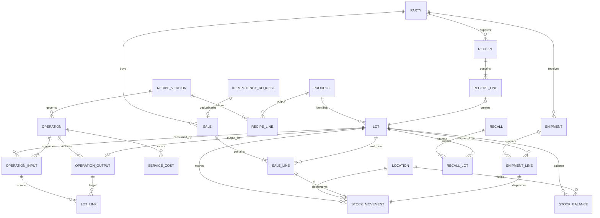

# Veri modeli — planlanan, henüz migration değil

Merkezi veri MySQL 8 / InnoDB. UUID kimlikleri CHAR(36), UTC DATETIME(6), miktar DECIMAL(18,6), maliyet DECIMAL(18,6), nihai EUR tutarı DECIMAL(18,2). Para API'de string. Ürün stok birimi tek ve açık; kg↔paket dönüşümü ürün bazında sürümlenir. Bu diyagram başlangıç şema sözleşmesidir; tablolar henüz oluşturulmadı.

| Tablo | Önemli alanlar ve kısıtlar |
| --- | --- |
| party | supplier/customer/producer rolü, ad, iletişim; gerekli alıcı iletişimi erişim kontrollü |
| product | SKU unique, ad, tür (raw/finished/byproduct), base_unit, paket kg dönüşüm sürümü |
| receipt / receipt_line | supplier_id, belge/tarih; product_id, lot_id, quantity>0, toplam gerçek net maliyet, currency=EUR |
| lot | product_id, supplier_id nullable, external_code, received_at, expires_at nullable, blocked; üretilen lot için receipt_line gerekmez (yukarıdaki ilişki receipt_line yönünde zorunlu) |
| location | depo/dış üretici/karantina; dış üreticideki stok da işletmeye aittir |
| recipe_version / recipe_line | tür, version unique, ürünler, planlanan oranlar, maliyet anahtarı quantity/value, değer katsayıları; kullanılan sürüm değiştirilemez |
| operation | kind=external_production/cutting/rework, code unique, producer_id nullable, recipe_version_id, status=draft/posted, tarihi; kapanışta cost snapshot, fark miktarı ve açıklaması |
| operation_input | operation_id, lot_id FK, gerçek consumed_quantity>0, gönderilen/iade miktarları ayrı hareketler; bir lot birçok emre girebilir |
| operation_output | operation_id, lot_id FK unique, quantity>0, kind=product/byproduct, allocated_cost, allocation_weight snapshot |
| lot_link | input_id FK, output_id FK, attributed_input_quantity>0; unique(input_id,output_id). Her iki satır aynı operasyonda olmalı; her girdinin dağıtılan miktarı fiili tüketime eşit |
| service_cost | operation_id, fatura referansı, amount>=0, currency; hammadde bedelini tekrar içermez |
| stock_movement | lot_id, location_id, signed_quantity≠0, type, transfer_group_id nullable, operation/receipt/sale/shipment referansı, reversal_of nullable, timestamp; immutable |
| stock_balance | PK(lot_id,location_id), quantity>=0; defterden türetilebilir, transaction içinde güncellenir |
| sale / sale_line | müşteri nullable (anonim perakende), client_request_id; satır lot FK, quantity>0, net fiyat, stock_movement_id unique FK |
| shipment / shipment_line | alıcı ve iletişim snapshot, sevk tarihi, lot FK, quantity, stock_movement_id unique FK; satışa bağlı sevkiyatta ikinci kez stok düşürülmez |
| recall / recall_lot | reason, source_lot_id, opened_at; PK(recall_id,lot_id), status; kaynak ve transitive türev lotlar |
| idempotency_request | scope+key unique, request_hash, response, status, created_at; satış ve diğer posted komutların güvenli tekrarı |

## İşlem bütünlüğü

- Sevk bir mülkiyet tüketimi değildir: aynı lotun depodan dış üretici konumuna iki eşleşen hareketi tek transaction içinde yazılır. Tüketim/çıktı kabulü kapanışta kaydedilir.
- Stok değiştiren işlem: idempotency kontrolü → ilgili lotları ve bakiye satırlarını deterministik ID sırasıyla `SELECT ... FOR UPDATE` → blok/son tarih/stoğu doğrula → hareket ve bakiye → maliyet/lot bağlantıları → commit. Hata halinde tamamı rollback. Yeni bakiye satırı unique kısıtıyla yarışa karşı korunur.
- Recall ve satış aynı lot kilitleme protokolünü kullanır. Recall oluştururken soy grafına bağlı lotlar sabit sırada kilitlenir; üretim de girdileri kilitleyip blok durumunu kontrol eder. Kapanmış graf değiştirilemez; yeni türev oluşturma recall ile yarışamaz. Deadlock için sınırlı transaction retry uygulanır.
- Lot_link döngü oluşturamaz; yalnızca yeni çıktı lotlarına yönelir. Geri/ileri rapor visited kümesiyle çok adımlı dolaşır. Tahmini bir karışım oranı gerçek kayıt diye sunulmaz; kesin ayrım bilinmiyorsa bütün ortak çıktılar etkilenmiş sayılır.
- Dağıtılan tutar toplamı girdi gerçek tüketim maliyeti + hizmete eşittir. Kuruş artığı deterministik satıra gider; gösterim yuvarlaması defter toplamını değiştirmez.
- İade ve yeniden işleme kaynak lot ve ters hareket referansını korur. Bilinen alıcı yoksa izleme “anonim/bilinmiyor” der. İkinci kademe dağıtım yalnızca ayrı kaydı varsa raporlanır.

Gelecek MySQL testleri: eşzamanlı çift satış negatif stok üretmez; recall/satış yarışı; deadlock retry; idempotent tekrar; para dağıtım toplamı; çoktan çoğa ve çok adımlı lot grafı. SQLite bu testlerin yerine geçmez.
