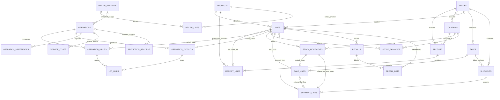

# Uygulanan veri modeli

Görev 12; kaynak taban `12dbb144497d3c35697a53debabbf218d53a0684`. Merkezi otorite MySQL 8 / InnoDB; Alembic head **dc9109a1f001**, **24 domain tablosu**. [Makine okunur şema](release-validation/schema.json), [migration/kilit testleri](release-validation/backend-tests.txt). Bu belge taslak değil, mevcut uygulamanın sözleşmesidir.

UUID'ler VARCHAR(36), zamanlar UTC DATETIME(6), miktar/lot maliyeti DECIMAL(18,6), satış birim fiyatı/tutarı DECIMAL(18,2). API para/miktarları metindir. `package_weight_kg` ürün kartında tutulur; ayrı paket dönüşüm sürüm tablosu yoktur. Ürün/reçete güncelleme kapsamı aşağıda belirtilir.

| Tablolar | Uygulanan kapsam |
| --- | --- |
| products | SKU unique; raw/finished/byproduct; kg/package/unit; species ve paket kg. Kartlar create/list ile yönetilir; ayrı bir fiyat listesi/VKP alanı yoktur. |
| parties / locations | İş ortağı rolleri JSON, iletişim; warehouse/external_producer/quarantine. Bunlar kullanıcı oturumu veya RBAC rolleri değildir. |
| receipts / receipt_lines / lots | Tedarikçi, kabul konumu, zaman, referans, lot FK, miktar, toplam maliyet, opsiyonel alış birim fiyatı/SKT. Lot kodu global unique değildir. Üretilen lotun alış satırı olmayabilir. |
| recipe_versions / recipe_lines | `(code,version)` unique; tür/giriş ürünü, quantity/value, parça ürünleri ve referans EUR/kg. Eski sürüm maliyeti değişmez; availability ayrı komuttur. |
| operations / inputs / outputs / differences / service_costs | Taslak/kesin kapanış, gerçek tüketim ve maliyetler, çıktı lotları, açıklanmış fire/diğer kayıp, hizmet faturası. `allocation_snapshot` reçeteyi işlemde dondurur. DB'de rework türünün ayrılmış olması çalışan rework API'si anlamına gelmez. |
| lot_links | Gerçek input/output FK çiftleri; unique(input_id,output_id); miktar atfı. İsim veya model tahmininden bağ üretilmez. |
| stock_movements / stock_balances | İmzalı değişmez defter; lot/konum bakiyesi PK ve negatif stok CHECK. Transfer grubu ve `reversal_of` alanları vardır; genel transfer/müşteri iadesi/iptal API'leri henüz yoktur. |
| sales / sale_lines | Müşteri zorunlu FK; kesin net fiyat/tutar ve **consumed_cost** snapshot'ı; benzersiz stok hareketi. Tarihsel kârlılık bu maliyetten okunur; bugünkü stok veya gösterim EKP'sinden türetilmez. |
| shipments / shipment_lines | Alıcı/iletişim snapshot'ı; bağlı sevk tam satış satırının hareketini paylaşır; bağımsız sevk yeni hareket oluşturur. Aynı hareket iki sevkiyatta kullanılamaz. |
| recalls / recall_lots | Kaynak ve transitive türev üyeliği, atomik blok. Ayrı status/lifecycle veya blok kaldırma endpoint'i yoktur. |
| idempotency_requests | PK(scope,key); canonical request hash + orijinal durum/cevap. İş kaydıyla aynı transaction. JSON cevapta ID bulunması Sale'a fiziksel FK olduğu anlamına gelmez. |
| prediction_records | Append-only tahmin/model/özellik/bağlam/sonuç snapshot'ı; yalnız operation_id gerçek FK. Bağlam JSON'undaki ürün eşlemeleri snapshot'tır; ledger/recall kararlarını yönetmez. |

## Transaction ve raporlama

İlgili lotlar deterministik sırayla `FOR UPDATE` kilitlenir; bloke/SKT/bakiye yeniden kontrol edilir. Defter, bakiye, kesin maliyet, lot bağları ve idempotency cevabı birlikte commit/rollback olur. Yeni bakiye yarışları unique kısıtla korunur. Recall grafı kilitlerden sonra yeniden doğrulanır. Gerçek InnoDB 1213 deadlock sonrası aynı komutun tekrarını ve kısmi yazıların geri alınmasını Görev 12 testi doğrular; limit üç denemedir. Limit tüketimi ayrıca kontrollü sürücü hatasıyla sınanır.

Dağıtım toplamı gerçek tüketim + hizmet toplamına eşittir. 18,16 EUR gösterim EKP'si 85 ile çarpılıp yeni toplam yaratılmaz. Kısmi lotlarda kümülatif maliyet yuvarlaması son tüketimde artığı korur.

`GET /v1/sales/{id}/profitability` yalnız SaleLine net tutarı ve `consumed_cost` üzerinden VKP, brüt kâr ve marj okur. Yeni muhasebe kaydı/migration oluşturmaz; iade, vergi, iskonto ve genel gider hesabı değildir. Farklı stok birimleri tek miktar toplamında birleştirilmez.

İleri/geri izleme visited kümesiyle bütün kesin grafı dolaşır. Kaydı olmayan market kalanı, son tüketici satışı ve ikinci kademe dağıtım **bilinmiyor/null** kalır. İkinci kademe dağıtım kayıt tablosu yoktur. Genel transfer, müşteri iadesi/ters hareket ve rework için ayrı API/migration/yarış testleri gerekir; ayrılmış alanlar tamamlanmış özellik sayılmaz.

Room'un sekiz cihaz tablosu MySQL'in kopyası veya stok otoritesi değildir: [Android veri sözleşmesi](../android/README.md). Offline yalnız taslak, kesin satış server onayından sonra; değişmez key/body outbox'ta korunur.
